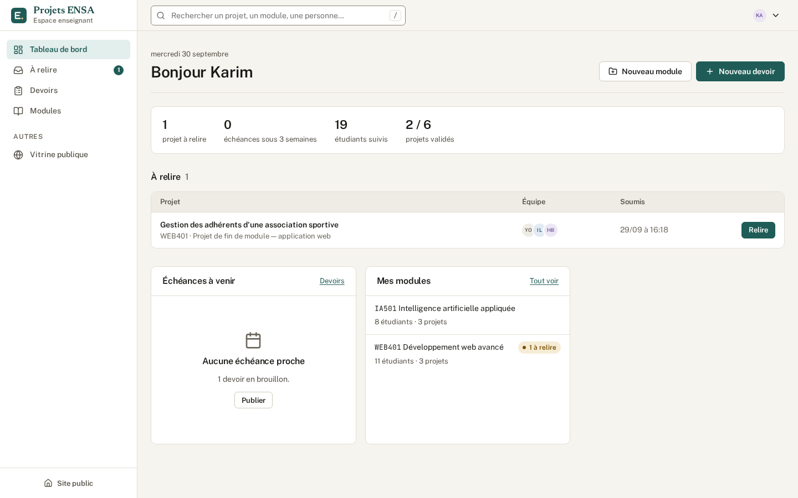
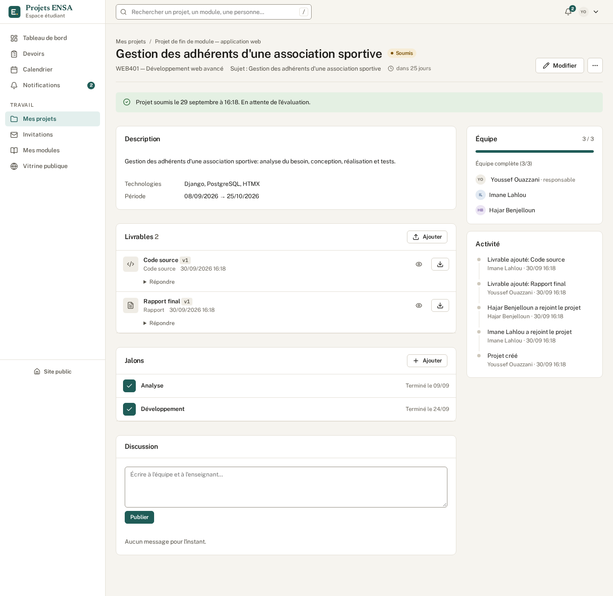
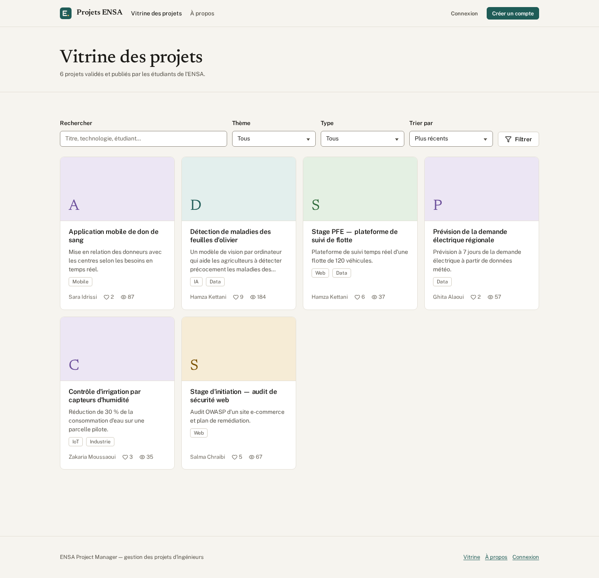

# Projets ENSA — ENSA Project Manager

A web platform for engineering-school projects: teachers publish assignments, students
form teams and hand in versioned deliverables, teachers review and grade, and the best
projects go on a public showcase. The interface is in French.



## What it does

**Students** — join modules with a code, see assignments and deadlines (calendar + `.ics`
feed), pick a subject, build a team (invitations, a "looking for a team" board), upload
deliverables (every upload with the same name becomes a new version), follow milestones,
discuss with the teacher, submit, and publish finished projects on the showcase.

**Teachers** — create assignments (imposed subject or a list of subjects to choose from,
individual or team work, deadlines), publish them, follow who handed in what, review
submissions (validate, ask for changes, reject), comment on each file, grade with a rubric,
export results to Excel, post announcements to a module.

**Administrators** — approve sign-ups, import students and teachers from Excel, manage
modules and teacher assignments, moderate reported showcase projects, export data.

**Everyone** — a public showcase with likes, comments and reports; role-aware search
(press `/`); email notifications or a daily digest; light and dark themes.

| | |
|---|---|
|  |  |

## Quick start (development)

Requirements: Python 3.13+, `make`. SQLite is used by default.

```bash
make setup            # virtualenv, dependencies, database
make seed             # demo data — every account's password is demo12345!
make run              # http://127.0.0.1:8000
```

Demo accounts: `admin`, `prof.alami` (teacher), `etu.youssef` (student with a team),
`etu.anas` (student without a team).

## Commands

| Command | |
|---|---|
| `make check` | lint, Django checks (including production settings), migrations, full test suite |
| `make test` | tests only (~290, about a minute) |
| `make e2e` | browser journeys with Playwright (`.venv/bin/playwright install chromium` once) |
| `make qa` | screenshot every page as every role; fails on JS errors, CSP violations or accessibility issues |
| `make coverage` | test coverage report |
| `make docker-up` | the production stack locally |

## Deployment

Docker Compose with PostgreSQL, gunicorn, Caddy (automatic HTTPS), a scheduler for daily
reminders, and nightly backups. Step by step: **[docs/DEPLOY.md](docs/DEPLOY.md)**.
Running it day to day: **[docs/OPERATIONS.md](docs/OPERATIONS.md)**.

## Stack

Django 5.2 LTS · PostgreSQL 16 · server-rendered templates with HTMX · a small
self-hosted design system (no CSS framework, no CDN) · WhiteNoise · django-axes ·
enforced Content Security Policy · Playwright for browser tests.

Project layout and conventions for contributors: [CLAUDE.md](CLAUDE.md).
History: [CHANGELOG.md](CHANGELOG.md).
